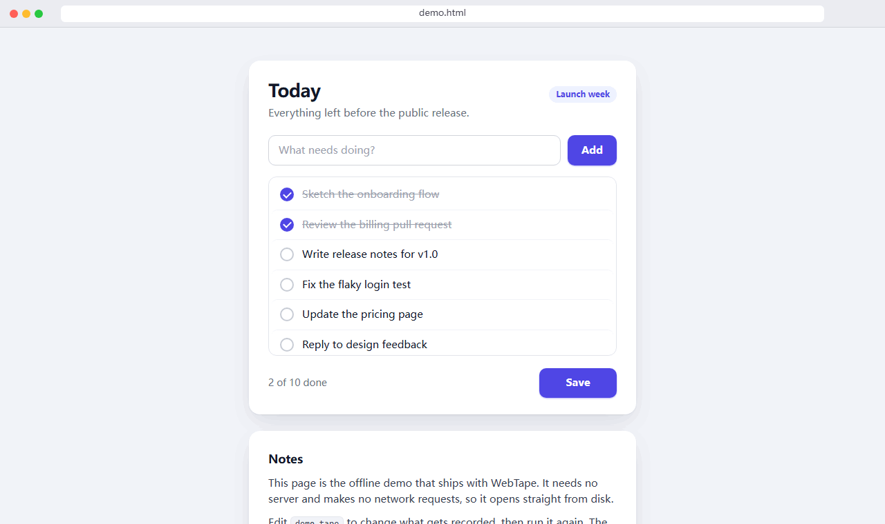

# WebTape

VHS for the web: write a browser demo as a plain-text `.tape` script, and one command records it as a GIF, WebM or MP4.



WebTape recorded the GIF above itself from [`templates/demo.tape`](templates/demo.tape). Run `npm run demo` to record it again.

WebTape drives headless Chromium with Playwright and captures the page one frame at a time. It adds a browser window frame, a fake cursor that glides to each target, a ripple on every click and typing that appears one character at a time. The same tape always gives the same frame count, size and duration. When the UI changes, rerun one command to get a fresh demo. You don't need ffmpeg or any API key.

## Install

You need Node.js 20 or newer.

WebTape is not on npm yet. To use it from source:

```
git clone https://github.com/zhushen12580/webtape.git
cd webtape
npm install
npm run build
```

After that, run it as `node <path-to-webtape>/dist/cli.js`. You can also run `npm link` once in the repository to get a global `webtape` command. The examples below use `webtape`.

Once it is published, the npm package will be called `webtape-cli` and you'll be able to run `npx webtape-cli` without cloning.

The first run downloads Chromium (about 120 MB) and needs no setup from you. Playwright keeps the download in its default location (`%LOCALAPPDATA%\ms-playwright` on Windows), or in `PLAYWRIGHT_BROWSERS_PATH` if you set it.

## Quick start

```
mkdir my-demo
cd my-demo
webtape init
webtape run demo.tape
```

`webtape init` writes an offline example, `demo.tape` plus the page it records, `demo.html`. `webtape run` records it:

```
Recording demo.tape -> 148 frames (7.40s @ 20 fps)
Wrote demo.gif (1280x760, 148 frames, 7.40s, 1.0 MB)
```

Here is `demo.tape`:

```
# WebTape demo. Record it with: webtape run demo.tape
Output demo.gif
Viewport 1280 720
Set Framerate 20
Set Theme light
Set TypingSpeed 50ms

Goto demo.html
Wait "#new-todo"
Sleep 500ms
Click "#new-todo"
Type "Record a demo with WebTape"
Press Enter
Sleep 500ms
Click "#save"
Wait "text=Saved"
Sleep 1s
Scroll "#todo-list" 240
Sleep 500ms
Scroll 400
Sleep 1s
```

To record your own app, change the `Goto` line to your page (for example `Goto http://localhost:5173`) and change the steps to match it.

## Tape commands

Each command takes a fixed amount of video time. A command that takes `d` of video time produces `round(d x fps / 1000)` frames. Your machine's speed and how fast the page loads don't change that count.

| Command | Arguments | Behavior | Duration |
|---|---|---|---|
| `Output <path>` | Extension `.gif`, `.webm` or `.mp4` (any case) | Declares an output file. You can repeat it, but no two paths may be the same | 0 |
| `Viewport <w> <h>` | Even integers, w from 320 to 1920, h from 200 to 1080 | Sets the page viewport. Default `1280 720` | 0 |
| `Set <Key> <Value>` | See the settings table below | Sets a recording option | 0 |
| `Goto <url>` | One argument | Navigates and waits for the `load` event (30s timeout). It shows as a hard cut in the video | 0 |
| `Click <selector>` | One argument | Waits for the element to be visible (10s timeout) and instantly scrolls it into view if needed, which adds no frames. The cursor then eases from where it is to the element's center, and WebTape clicks for real and shows a ripple | 700ms (500ms move + 200ms hold) |
| `Type <text>` | One non-empty argument | Sends real key events one character at a time to the focused element. Any Unicode text works, including CJK and emoji | characters (code points) x TypingSpeed |
| `Press <key>` | A Playwright key name such as `Enter`, `Tab`, `Escape`, `ArrowDown` or `Control+A` | Presses the key once | 200ms |
| `Scroll [selector] <pixels> [duration]` | pixels is a non-zero integer up to 100000 in absolute value. Positive scrolls down, negative scrolls up. duration defaults to `500ms` | Scrolls the whole page, or the container that matches the selector (it waits up to 10s for it to be visible), with easing | duration |
| `Wait <selector> [timeout]` | timeout defaults to `10s` and can be from 100ms to 60s | Waits for the element to be visible. Adds no frames, so it shows as a hard cut | 0 |
| `Sleep <duration>` | More than 0, at most 60s | Keeps capturing frames while the page runs | duration |

Settings for `Set`:

| Key | Value | Default |
|---|---|---|
| `Framerate` | Integer from 1 to 50 | `20` |
| `Theme` | `light`, `dark` or `none` | `light` |
| `TypingSpeed` | Duration from 10ms to 1s | `50ms` |

Rules:

- There is one command per line. Blank lines are skipped, and a line whose first non-blank character is `#` is a comment. A `#` later in the line is not a comment, so `Click #add` works.
- Separate arguments with spaces. To include a space, wrap the argument in `"double quotes"` (which support the escapes `\"` and `\\`) or in `'single quotes'` (which have no escapes).
- Command names and `Set` keys are case-sensitive PascalCase, as in VHS. If you misspell one, the error suggests the closest match: `Unknown command "Clik". Did you mean "Click"?`
- Durations must include a unit: `500ms`, `1.5s`.
- Selectors are CSS by default. `text=Foo` matches any element whose text contains "Foo", ignoring case. `text="Foo"` matches the exact text. If several elements match, WebTape uses the first visible one.
- `Viewport` and `Set` must come before the first action, and the first action must be `Goto`. A tape can be at most 300s long.
- Relative paths in a tape (`Output`, and local files in `Goto`) are relative to the tape's own folder, not to the folder you run it from. A `Goto` argument that doesn't start with `http://`, `https://`, `file://`, `about:` or `data:` counts as a local file path.
- WebTape checks the whole tape before it starts the browser and reports every error at once.

## Output formats

- **GIF**: every frame is a GIF frame, with 256 colors per frame and an infinite loop.
- **WebM**: VP9.
- **MP4**: H.264, with the index at the start of the file (fastStart) so browsers can start playing it right away.

Everything is encoded inside Chromium (WebCodecs and [mediabunny](https://github.com/Vanilagy/mediabunny) for video, [gifenc](https://github.com/mattdesl/gifenc) for GIF), so you don't need ffmpeg. A tape can have several `Output` lines. WebTape captures the frames once and encodes them into every format you ask for. With no `Output` and no `-o`, it writes `<tape name>.gif` next to the tape.

The window frame comes from `Set Theme`:

- `light` (the default) and `dark` add a 40px title bar with three dots and an address bar on top of the page. The output is W x (H+40).
- `none` gives just the page, W x H.

The address bar shows only the host and path of the URL, or the file name for local files. It never shows query strings, hashes or full local paths, so a published demo can't leak a token or `C:\Users\<you>\...`.

## CLI

```
webtape init [--force]                     Write demo.tape and demo.html to the current directory
webtape run <file.tape> [-o <path>]...     Record a tape; -o replaces every Output in the tape
webtape --help | -h
webtape --version | -v
```

- `init` won't overwrite existing files unless you pass `--force`.
- `-o` can be repeated, and its paths are relative to the current directory.
- Exit codes: `0` means success. `1` means a parse, runtime or encoding error. `2` means a usage error, such as an unknown subcommand or a missing argument.
- Errors name the tape and the line:

```
missing.tape:4: Wait failed: "#missing" not visible within 1s
```

- WebTape writes files only after every output has encoded. If anything fails, it writes nothing, and the result of your last good run stays in place.

## Let your agent record the demo

A tape is plain text and every error points to a line, so a coding agent such as Claude Code or Codex can record a demo of the feature it just built:

1. Start the dev server and write a tape for the new feature.
2. Run `webtape run feature.tape`.
3. If the exit code is not 0, read the `file:line` error, fix that line (usually a selector or a timeout) and run it again.
4. When it succeeds, attach the GIF or MP4 to the pull request.

An example for a Vite app on port 5173:

```
Output docs/feature.gif
Output docs/feature.mp4
Viewport 1280 720

Goto http://localhost:5173
Wait "text=Sign in"
Click "#email"
Type "ada@example.com"
Click "text=Sign in"
Wait "text=Welcome"
Sleep 1s
```

You can paste something like this into your agent's instructions: "After finishing a UI change, write a `.tape` that shows it, run `webtape run`, fix any `file:line` errors until it exits 0, and attach the output to the PR."

## How it relates to VHS

[charmbracelet/VHS](https://github.com/charmbracelet/vhs) records terminal sessions from `.tape` files, and WebTape borrows the idea for web pages. The commands use the same style (`Output`, `Set Key Value`, `Type`, `Sleep`, PascalCase names), but the command set is built for browsers: `Goto`, `Click`, `Scroll` and `Wait` act on real pages. WebTape is a separate project and is not affiliated with Charm.

## Known limitations

- The page runs in real time while WebTape takes screenshots, so the page's own CSS and JS animations look faster in the video than they really are.
- Chromium only. Firefox and WebKit are not supported.
- There is no Hover, double click, right click, drag and drop, file upload, iframe, popup or multi-tab support.
- Pixels can differ slightly between runs, but the frame count, size and duration are always the same.
- Output is at device scale factor 1. There is no HiDPI output, no transparent background and no rounded or shadowed window.
- Pages that use ES modules don't work over `file://`. Serve them from your own dev server instead.
- Only Windows 11 has been tested so far. Linux and macOS are expected to work.

## Development

```
npm install
npm test
npm run coverage
npm run typecheck
npm run demo
npm run dev
```

- `npm test` builds and then runs the unit tests and the end-to-end tests, which use real Chromium.
- `npm run coverage` reports coverage for the parser and the shared helpers.
- `npm run demo` records `templates/demo.tape` to `docs/demo.gif`.
- `npm run dev` rebuilds on every change.

## License

MIT, see [LICENSE](LICENSE).

Built with Claude Code & Codex
