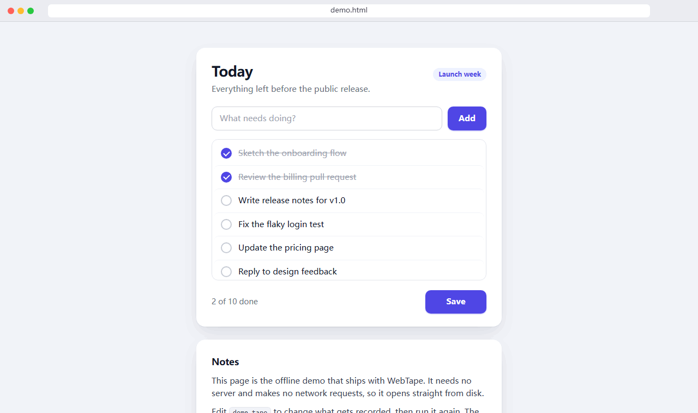
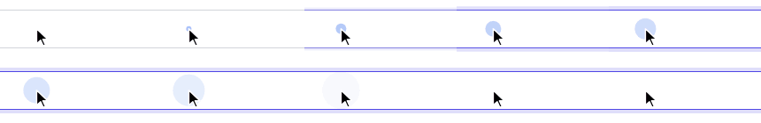
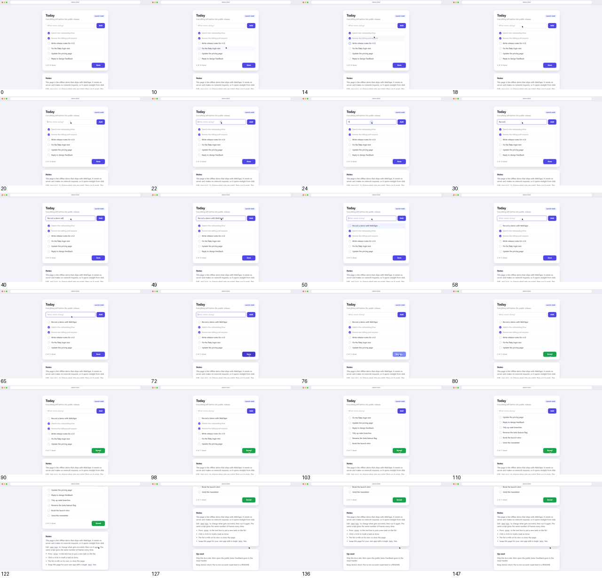

# WebTape

**网页版的 VHS。** 把浏览器里的演示步骤写成一个纯文本 `.tape` 脚本，一条命令就能录成 GIF、WebM 或 MP4。

[English](README.md) | 简体中文



上面这张 GIF 就是 WebTape 用 [`templates/demo.tape`](templates/demo.tape) 自己录的，运行 `npm run demo` 可以重新录一遍。

## 特性

- **演示即代码。** tape 是一个很短的文本文件，由 `Goto`、`Click`、`Type`、`Press`、`Scroll`、`Wait`、`Sleep` 这类步骤组成。UI 改了，改一行或者直接重跑就行。
- **看起来像真人在操作。** 带地址栏的浏览器窗口边框（浅色或深色），光标缓动移到每个目标，每次点击都有涟漪，文字逐字打出来。
- **同一个 tape，同一段视频。** 帧数、尺寸和时长只由 tape 决定，跟机器快慢、页面加载快慢都无关。`Wait` 等待的时间不会出现在成片里。
- **一次录制，同时输出 GIF、WebM 和 MP4。** 所有编码都在 Chromium 里完成，不需要 ffmpeg，也不需要任何 API Key。首次运行会自动下载 Chromium。
- **适合编码 Agent。** 报错带 `文件:行号`，启动浏览器之前就检查完整个 tape，失败时退出码非零，而且失败不会覆盖上一次成功的输出。
- **可以放心公开。** 地址栏从不显示 query、hash 或本地完整路径。

## 快速开始

需要 Node.js 20 或更新版本。WebTape 还没有发布到 npm，所以先从源码构建：

```
git clone https://github.com/zhushen12580/webtape.git
cd webtape
npm install
npm run build
npm link
```

`npm link` 会把 `webtape` 命令加到 PATH 里。不想执行它的话，下文所有 `webtape` 都换成 `node <webtape 所在路径>/dist/cli.js`。发布之后，npm 包名会是 `webtape-cli`，届时不用克隆仓库，直接 `npx webtape-cli` 即可。

然后录第一段演示：

```
mkdir my-demo
cd my-demo
webtape init
webtape run demo.tape
```

`webtape init` 会生成一个离线示例：`demo.tape` 和它要录制的页面 `demo.html`。`webtape run` 负责录制：

```
Recording demo.tape -> 148 frames (7.40s @ 20 fps)
Wrote demo.gif (1280x760, 148 frames, 7.40s, 1.0 MB)
```

`demo.tape` 的内容：

```
# WebTape demo. Record it with: webtape run demo.tape
Output demo.gif
Viewport 1280 720
Set Framerate 20
Set Theme light
Set TypingSpeed 50ms

Goto demo.html
Wait "#new-todo"
Sleep 500ms
Click "#new-todo"
Type "Record a demo with WebTape"
Press Enter
Sleep 500ms
Click "#save"
Wait "text=Saved"
Sleep 1s
Scroll "#todo-list" 240
Sleep 500ms
Scroll 400
Sleep 1s
```

要录你自己的应用，把 `Goto` 那一行换成你的页面（例如 `Goto http://localhost:5173`），再按页面调整后面的步骤。

首次运行会自动下载 Chromium（约 120 MB），不需要你做任何配置。Playwright 会把它放在默认位置（Windows 上是 `%LOCALAPPDATA%\ms-playwright`），设置了 `PLAYWRIGHT_BROWSERS_PATH` 时则放在该目录。

因为 tape 可以打开任意网页，Chromium 始终开启沙箱。如果沙箱启动不了（例如在 Linux 上以 root 运行），WebTape 会直接报错退出，而不是关掉沙箱。

## Tape 命令

每条命令占用固定的成片时长。占用 `d` 的命令产生 `round(d x fps / 1000)` 帧，机器快慢和页面加载速度都不会改变这个数。

| 命令 | 参数 | 行为 | 成片时长 |
|---|---|---|---|
| `Output <path>` | 扩展名为 `.gif`、`.webm` 或 `.mp4`（不区分大小写） | 声明一个输出文件。可以写多次，但不能有两行指向同一个文件（`a.gif` 和 `./a.gif` 算同一个） | 0 |
| `Viewport <w> <h>` | 偶数整数，w 取 320–1920，h 取 200–1080 | 设置页面视口，默认 `1280 720` | 0 |
| `Set <Key> <Value>` | 见下方设置表 | 设置录制参数 | 0 |
| `Goto <url>` | 一个参数 | 导航并等待 `load` 事件（超时 30s）。成片里是硬切 | 0 |
| `Click <selector>` | 一个参数 | 等待元素可见（超时 10s），需要时瞬间滚动到可见位置（不产生帧）。然后光标从当前位置缓动到元素中心，WebTape 真实点击并显示涟漪。如果该点被别的元素挡住（外层的 button 或链接、元素的 label 不算遮挡），WebTape 最多等 10s 让它消失，否则报错并给出行号，所以点击不会悄悄落到错误的元素上 | 700ms（移动 500ms + 停留 200ms） |
| `Type <text>` | 一个非空参数 | 往当前焦点元素逐字输入，支持任意 Unicode，包括中文和 emoji。美式键盘上有的字符会发送真实的 `keydown`、`keypress`、`keyup` 事件；其他字符（带重音的字母、中日韩文字、emoji）以文本方式插入，页面只收到 `input` 事件，没有按键事件 | 字符数（按 code point 计）x TypingSpeed |
| `Press <key>` | Playwright 键名，如 `Enter`、`Tab`、`Escape`、`ArrowDown`、`Control+A` | 按一次键 | 200ms |
| `Scroll [selector] <pixels> [duration]` | pixels 是非零整数，绝对值不超过 100000，正数向下、负数向上。duration 默认 `500ms` | 带缓动地滚动整个页面，或滚动匹配选择器的容器（最多等 10s 让它可见） | duration |
| `Wait <selector> [timeout]` | timeout 默认 `10s`，范围 100ms–60s | 等待元素可见。不产生帧，成片里是硬切 | 0 |
| `Sleep <duration>` | 大于 0，最多 60s | 页面照常运行，持续截帧 | duration |

`Set` 的设置项：

| Key | 取值 | 默认 |
|---|---|---|
| `Framerate` | 1 到 50 的整数 | `20` |
| `Theme` | `light`、`dark` 或 `none` | `light` |
| `TypingSpeed` | 10ms 到 1s 的时长 | `50ms` |

规则：

- 一行一条命令。空行会被跳过，首个非空白字符是 `#` 的行是注释。行中间的 `#` 不算注释，所以 `Click #add` 是合法的。
- 参数之间用空格分隔。参数里要带空格时，用 `"双引号"`（支持 `\"` 和 `\\` 转义）或 `'单引号'`（不转义）包起来。
- 命令名和 `Set` 的键名区分大小写，采用 PascalCase，和 VHS 一样。拼错时会提示最接近的写法：`Unknown command "Clik". Did you mean "Click"?`
- 时长必须带单位：`500ms`、`1.5s`。
- 选择器默认是 CSS。`text=Foo` 匹配文本包含 "Foo" 的元素，不区分大小写；`text="Foo"` 是精确匹配。有多个匹配时，WebTape 取第一个可见的元素。
- `Viewport` 和 `Set` 必须写在第一条动作命令之前，且第一条动作命令必须是 `Goto`。一个 tape 最长 300s。
- tape 里的相对路径（`Output` 以及 `Goto` 的本地文件）相对于 tape 文件所在的目录，而不是你执行命令的目录。`Goto` 的参数不以 `http://`、`https://`、`file://`、`about:` 或 `data:` 开头时，按本地文件路径处理。
- WebTape 在启动浏览器之前检查整个 tape，一次报出所有错误。

## 输出格式

- **GIF**：每一帧都是一个 GIF 帧，每帧 256 色，无限循环。
- **WebM**：VP9。
- **MP4**：H.264，索引放在文件开头（fastStart），浏览器可以马上开始播放。

所有编码都在 Chromium 里完成（视频用 WebCodecs 和 [mediabunny](https://github.com/Vanilagy/mediabunny)，GIF 用 [gifenc](https://github.com/mattdesl/gifenc)），所以不需要 ffmpeg。一个 tape 可以写多行 `Output`，WebTape 只采集一遍帧，再编码成你要的每种格式。既没有 `Output` 也没有 `-o` 时，输出到 tape 旁边的 `<tape 文件名>.gif`。

窗口边框由 `Set Theme` 决定：

- `light`（默认）和 `dark` 会在页面上方加一条 40px 的标题栏，带三个圆点和地址栏，输出尺寸为 W x (H+40)。
- `none` 只有页面本身，尺寸为 W x H。

地址栏只显示 URL 的域名和路径，本地文件只显示文件名。它从不显示 query、hash 或本地完整路径，所以公开的演示不会泄露 token 或 `C:\Users\<你的名字>\...` 这样的路径。

## 命令行

```
webtape init [--force]                     Write demo.tape and demo.html to the current directory
webtape run <file.tape> [-o <path>]...     Record a tape; -o replaces every Output in the tape
webtape --help | -h
webtape --version | -v
```

- 不加 `--force` 时，`init` 不会覆盖已有文件。
- `-o` 可以重复使用，传了 `-o` 就替换 tape 里所有的 `Output`，路径相对于当前目录。
- 退出码：`0` 表示成功；`1` 表示解析错误、运行错误或编码错误；`2` 表示用法错误，比如未知子命令或缺少参数。
- 报错会给出 tape 文件名和行号：

```
missing.tape:4: Wait failed: "#missing" not visible within 1s
```

- 所有输出都编码成功后，WebTape 才写文件。任何一步失败都不写，上一次成功的结果原样保留。

## 让 Agent 录演示

tape 是纯文本，每个报错都指向具体的行，所以 Claude Code、Codex 这类编码 Agent 可以给自己刚做完的功能录一段演示：

1. 启动开发服务器，为新功能写一个 tape。
2. 运行 `webtape run feature.tape`。
3. 退出码不是 0 时，读 `文件:行号` 报错，改那一行（通常是选择器或超时），再跑一次。
4. 成功后，把 GIF 或 MP4 附到 PR 里。

一个 5173 端口上的 Vite 应用的例子：

```
Output docs/feature.gif
Output docs/feature.mp4
Viewport 1280 720

Goto http://localhost:5173
Wait "text=Sign in"
Click "#email"
Type "ada@example.com"
Click "text=Sign in"
Wait "text=Welcome"
Sleep 1s
```

可以在 Agent 的指令里加一句类似这样的话：“完成 UI 改动后，写一个展示它的 `.tape`，运行 `webtape run`，修好所有 `文件:行号` 报错直到退出码为 0，然后把输出附到 PR 里。”

## 工作原理

1. **检查。** WebTape 解析整个 tape，生成一条虚拟时间轴：占用 `d` 成片时长的命令分到 `round(d x fps / 1000)` 帧。有任何错误都在这一步停下，此时还没启动浏览器。
2. **播放。** Playwright 在无头 Chromium 里打开你的页面。每一帧，WebTape 先执行当前命令在这一帧的那一小段动作（鼠标移动一步、输入到期的字符、滚动一点），再截一张图。光标和涟漪从不加进页面的 DOM。
3. **合成。** 同一个 Chromium 里的另一个内部页面在 canvas 上画出每一帧：标题栏、截图、点击涟漪和光标。
4. **编码。** [gifenc](https://github.com/mattdesl/gifenc) 把这些帧编码成 GIF，WebCodecs 加 [mediabunny](https://github.com/Vanilagy/mediabunny) 把它们编码成 WebM 或 MP4。所有输出都编码成功后才写文件。

点击的特写：涟漪在光标下扩散，然后淡出。



演示 GIF 中的若干帧，标注了帧号。页面要 1.5 秒才显示 `Saved`，但 `Wait` 不产生帧，所以成片里点击之后几帧它就出现了。



## 与 VHS 的关系

[charmbracelet/VHS](https://github.com/charmbracelet/vhs) 用 `.tape` 文件录制终端会话，WebTape 把这个思路搬到了网页上。命令沿用同样的风格（`Output`、`Set Key Value`、`Type`、`Sleep`、PascalCase 命名），但命令集是为浏览器设计的：`Goto`、`Click`、`Scroll` 和 `Wait` 作用在真实页面上。WebTape 是独立项目，与 Charm 没有关联。

## 已知限制

- WebTape 截图的同时页面按真实时间运行，所以页面自身的 CSS 和 JS 动画在成片里会比实际快。
- 只支持 Chromium，不支持 Firefox 和 WebKit。
- 不支持悬停、双击、右键、拖放、文件上传、iframe、弹窗和多标签页。
- 每次录制的像素可能略有差异，但帧数、尺寸和时长始终相同。
- 输出的设备像素比固定为 1。不支持高 DPI 输出、透明背景，也没有圆角或阴影窗口。
- `Type` 只对美式键盘上有的字符发送按键事件（`keydown`、`keypress`、`keyup`）。带重音的字母、中日韩文字和 emoji 只触发 `input` 事件，所以只监听按键事件、不监听 `input` 的控件，对这类文字的反应可能不同。
- 使用 ES module 的页面无法通过 `file://` 打开，请改用你自己启动的开发服务器。
- 目前只在 Windows 11 上测试过，预期在 Linux 和 macOS 上也能用。

## 开发与测试

构建支持的 Node.js 版本与 CLI 相同。测试运行器（Vitest 5）需要更新的 Node.js：`^22.12.0 || ^24.0.0 || >=26.0.0`，运行 `npm test` 和 `npm run coverage` 时请使用其中之一。

```
npm install
npm test
npm run test:install
npm run coverage
npm run typecheck
npm run demo
npm run dev
```

- `npm test` 先构建，再运行单元测试和使用真实 Chromium 的端到端测试。
- `npm run test:install` 真实地检查首次安装：从一个空的浏览器目录开始，确认第一次录制会下载 Chromium（约 120 MB），第二次直接复用、不再安装。
- `npm run coverage` 统计解析器和共用工具函数的覆盖率。
- `npm run demo` 把 `templates/demo.tape` 录制到 `docs/images/demo.gif`。
- `npm run dev` 监听改动并自动重新构建。

## 许可证

MIT，见 [LICENSE](LICENSE)。

Built with Claude Code & Codex
